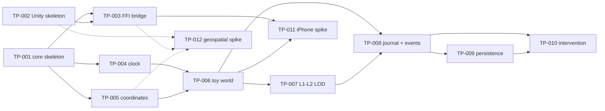

# Technical Prototype Backlog

Stage 1 of the roadmap ([19-roadmap.md](../architecture/19-roadmap.md), [20-mvp.md](../architecture/20-mvp.md) §21.2): **prove the foundational architecture only.** Each item is one GitHub issue, one branch, and one reviewable PR. The issues are the specification; this page is the map. Tracking issue: [#14](https://github.com/ndabney562/world-simulator/issues/14).

| ID | Issue | Title | Depends on | Area |
|---|---|---|---|---|
| TP-001 | [#2](https://github.com/ndabney562/world-simulator/issues/2) | Rust simulation-core skeleton | none | core |
| TP-002 | [#3](https://github.com/ndabney562/world-simulator/issues/3) | Unity 6 / URP project skeleton | none | unity |
| TP-003 | [#4](https://github.com/ndabney562/world-simulator/issues/4) | Rust ↔ Unity FFI bridge | TP-001, TP-002 | ffi |
| TP-004 | [#5](https://github.com/ndabney562/world-simulator/issues/5) | Simulation clock | TP-001 | core |
| TP-005 | [#6](https://github.com/ndabney562/world-simulator/issues/6) | Coordinate and reference-frame foundation | TP-001 | core |
| TP-006 | [#7](https://github.com/ndabney562/world-simulator/issues/7) | Toy-world entity model | TP-004, TP-005 | core |
| TP-007 | [#8](https://github.com/ndabney562/world-simulator/issues/8) | L1 ↔ L2 simulation-LOD round trip | TP-006 | core |
| TP-008 | [#9](https://github.com/ndabney562/world-simulator/issues/9) | Command journal + World Event system | TP-006, TP-007 | core |
| TP-009 | [#10](https://github.com/ndabney562/world-simulator/issues/10) | Persistence / save-load foundation | TP-008 | core |
| TP-010 | [#11](https://github.com/ndabney562/world-simulator/issues/11) | First structured god intervention | TP-008, TP-009 | core |
| TP-011 | [#12](https://github.com/ndabney562/world-simulator/issues/12) | iPhone 15 Pro build and performance spike | TP-003, TP-006 | ios |
| TP-012 | [#13](https://github.com/ndabney562/world-simulator/issues/13) | Geospatial / Cesium / visual-provider spike | TP-002, TP-003, TP-005 | unity |

## Dependency graph

TP-012 blocks nothing (ADR 0013): the core Rust → FFI → Unity → iPhone path is proved by TP-001 to TP-011 with simple primitives.

## Decisions locked in along the way

Several issues start with a short docs-only ADR PR that must be accepted before the implementation PR merges ([architecture-change-process.md](architecture-change-process.md)):

| Issue | ADR topic (from [21-decisions-now-vs-later.md](../architecture/21-decisions-now-vs-later.md)) |
|---|---|
| TP-003 | S-3 bridge details |
| TP-004 | D-5 time representation |
| TP-005 | D-4 coordinate representation (and S-4 default sector level) |
| TP-006 | S-1 ECS library, D-7 entity identity |
| TP-008 | D-8 command and mutation model |
| TP-009 | S-2 serialization format, D-14 version header |
| TP-011 | S-5 frame-rate target, S-6 Unity CI (if the data supports a decision) |

## Recommended order

1. **TP-001** first: everything in the core depends on it, and it turns on real Rust CI.
2. TP-002 in parallel (it needs the Product Owner's Mac to verify).
3. TP-004 and TP-005 (independent of each other), then TP-003 once TP-001 and TP-002 are merged.
4. TP-006 → TP-007 → TP-008 → TP-009 → TP-010, with TP-011 as soon as TP-003 and TP-006 are merged, so device risk is found early.
5. TP-012 whenever its dependencies are in, without holding anything else.
