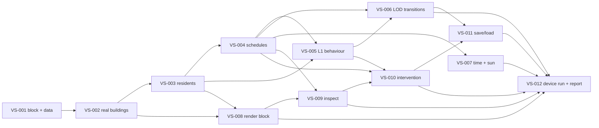

# Vertical Slice Backlog

Stage 2 of the roadmap ([19-roadmap.md](../architecture/19-roadmap.md), [20-mvp.md](../architecture/20-mvp.md) §21.3): **run every architectural spine end to end on one real Bay Ridge block**, with 10 to 30 synthetic people. Visual polish is not a requirement. Each item is one GitHub issue, one branch, and one reviewable PR. The issues are the specification; this page is the map. Tracking issue: [#77](https://github.com/ndabney562/world-simulator/issues/77). The Technical Prototype ([backlog](technical-prototype-backlog.md)) is complete.

| ID | Issue | Title | Depends on | Area |
|---|---|---|---|---|
| VS-001 | [#65](https://github.com/ndabney562/world-simulator/issues/65) | Choose the block and register its open data | none | data |
| VS-002 | [#66](https://github.com/ndabney562/world-simulator/issues/66) | Real buildings in the core | VS-001 | core |
| VS-003 | [#67](https://github.com/ndabney562/world-simulator/issues/67) | Synthetic residents, households, workplaces | VS-002 | core |
| VS-004 | [#68](https://github.com/ndabney562/world-simulator/issues/68) | Daily schedules (L2) and schedule events | VS-003 | core |
| VS-005 | [#69](https://github.com/ndabney562/world-simulator/issues/69) | L1 needs, utility decisions, sidewalk pathfinding | VS-003, VS-004 | core |
| VS-006 | [#70](https://github.com/ndabney562/world-simulator/issues/70) | Camera-driven LOD transitions with conservation checks | VS-004, VS-005 | core |
| VS-007 | [#71](https://github.com/ndabney562/world-simulator/issues/71) | Real date, sun position, time controls | VS-004 | core, unity |
| VS-008 | [#72](https://github.com/ndabney562/world-simulator/issues/72) | Render the real block in Unity | VS-002, VS-003 | unity |
| VS-009 | [#73](https://github.com/ndabney562/world-simulator/issues/73) | Tap to inspect a person or building | VS-004, VS-008 | unity, ffi |
| VS-010 | [#74](https://github.com/ndabney562/world-simulator/issues/74) | "Curse with illness" with linked consequences | VS-004, VS-005, VS-009 | core |
| VS-011 | [#75](https://github.com/ndabney562/world-simulator/issues/75) | Save and load the whole slice | VS-006, VS-010 | core |
| VS-012 | [#76](https://github.com/ndabney562/world-simulator/issues/76) | iPhone 20-minute run and exit report | VS-006 to VS-011 | ios |

## Dependency graph

## Exit criteria and the issues that prove them

| Exit criterion ([20-mvp.md](../architecture/20-mvp.md) §21.3) | Proved by |
|---|---|
| 1. Zooming never loses or duplicates a person | VS-006 |
| 2. Block aggregates equal the individuals | VS-006 |
| 3. Save, quit, load reproduce the state hash | VS-011 |
| 4. Consequences of the intervention are listed with confidence classes | VS-010 |
| 5. Toggling the Google backdrop does not change the state hash | Needs the optional TP-012 ([#13](https://github.com/ndabney562/world-simulator/issues/13)) first, or a Product Owner waiver at VS-012 |
| 6. Stable frame rate on the iPhone 15 Pro for 20 minutes | VS-012 |

## Decisions locked in along the way

| Issue | Decision (from [21-decisions-now-vs-later.md](../architecture/21-decisions-now-vs-later.md)) |
|---|---|
| VS-001 | S-8 which block; D-22 data-source register entries |
| VS-005 | L1 behaviour model (Proposed ADR if locked in) |
| VS-006 | Camera-interest command (ADR if the command format changes) |
| VS-008 | Real-slice render transport; accepted ABI5 in ADR0031 after VS-007 consumes ABI4 |
| VS-011 | Save format version bump (ADR 0020 amendment or new ADR) |
| VS-012 | S-5 frame-rate target, re-made on the slice's load |

## Recommended order

1. **VS-001** first: everything depends on the chosen block and its data. It needs the Product Owner to confirm the block.
2. VS-002 → VS-003, then VS-004 and VS-008 in parallel (core and Unity), so device risk shows early.
3. VS-005, VS-007 and VS-009 as their dependencies merge.
4. VS-006 and VS-010, then VS-011.
5. VS-012 last, on a final build.

Issue bodies are drafts of the scope: the Product Owner authorizes each issue before work starts, and the issue text can be corrected first.

### VS-009 inspection design checkpoint

[ADR0032](../adr/0032-read-only-slice-inspection.md) is a local Proposed design for #73. A separate architecture-change issue and docs-only PR remain pending publication approval. No inspection runtime begins before accepted design and #72 engineering integration; #72/#73 device criteria remain open.
